<!-- DSA_DESIGN_hero_START -->
<p><picture><source media="(max-width: 600px)" srcset="assets/readme/hero-mobile.svg"/>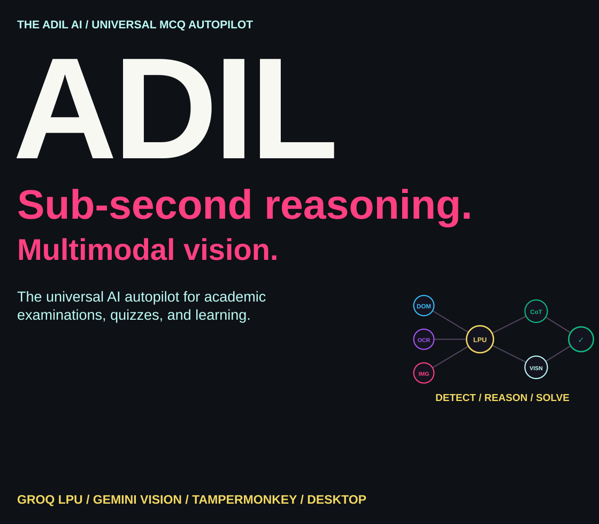</picture></p>
<!-- DSA_DESIGN_hero_END -->

<div align="center">


# 🚀 The Adil AI - Universal MCQ Solver & Autopilot Suite

### Sub-Second LPU Reasoning • Multimodal Vision • Multi-Select Automation • Dual Desktop & Browser Engines


<br>

<!-- BADGES_START -->
<a href="https://github.com/adilsukumar/The-Adil-AI"></a>
<a href="https://console.groq.com"></a>
<a href="https://aistudio.google.com"></a>
<a href="#-progress-dashboard"></a>
<a href="#-verified-platforms-breakdown"></a>
<a href="LICENSE"></a>
<!-- BADGES_END -->

<br>


</div>

---

<!-- DSA_DESIGN_directory_START -->
<p><picture><source media="(max-width: 600px)" srcset="assets/readme/section-directory-mobile.svg"/>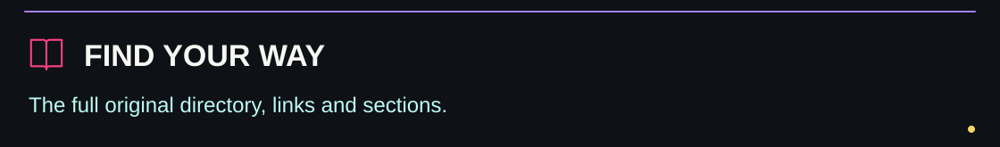</picture></p>
<!-- DSA_DESIGN_directory_END -->

## 📌 Quick Navigation

<p align="center">
  <a href="#-about-this-repository">About</a> •
  <a href="#-goals">Goals</a> •
  <a href="#-progress-dashboard">Progress</a> •
  <a href="#-problem-index--core-capabilities">Capabilities</a> •
  <a href="#-verified-platforms-breakdown">Platforms</a> •
  <a href="#-tech-stack">Tech Stack</a> •
  <a href="#-repository-structure">Structure</a> •
  <a href="#-how-this-repository-stays-updated">Automation</a> •
  <a href="#-github-analytics">Analytics</a> •
  <a href="#-connect-with-me">Contact</a>
</p>

---

<!-- DSA_DESIGN_practice_START -->
<p><picture><source media="(max-width: 600px)" srcset="assets/readme/section-practice-mobile.svg"/>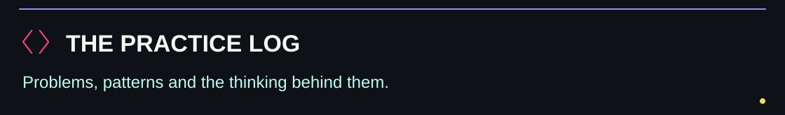</picture></p>
<!-- DSA_DESIGN_practice_END -->

## 📖 About This Repository

This repository documents and maintains **The Adil AI** — an advanced dual-engine AI suite engineered to autonomously detect, verify, reason through, and solve Multiple Choice Questions (MCQs) and Multi-Select (checkbox) assessments in real time.

The objective is not only to automate question solving but to develop:

* **Sub-Second LPU Latency** — Groq ultra-fast 200ms - 300ms inference pipelines
* **Deep Algorithmic Thinking** — Step-by-step Chain-of-Thought verification eliminating distractors
* **Universal DOM Parsing** — True-LCA ancestor clustering algorithm running across any web portal
* **Multimodal Visual Intelligence** — Autonomous Gemini Vision routing for diagrams, charts, and maps
* **Multi-Select Consistency** — Seamless multi-answer checkbox resolution without front-end state desync
* **Silent Desktop Automation** — Zero-CMD footprint Windows desktop autopilot with audio chime feedback

Problems and quizzes are solved across:

* 🪁 KiteRooms Assessment Slides
* 📋 Google Forms (Single-choice & Multi-Select Checkboxes)
* 🎮 Quizizz Live Games & SPAs
* 📚 Britannica Quizzes & Web Portals
* 🌐 Custom React, Vue, Angular, and Tailwind Web Applications

---

<!-- DSA_DESIGN_goals_START -->
<p><picture><source media="(max-width: 600px)" srcset="assets/readme/section-goals-mobile.svg"/>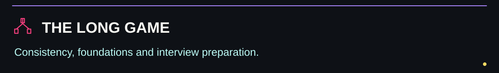</picture></p>
<!-- DSA_DESIGN_goals_END -->

## 🎯 Goals

* Maintain **95%+ Accuracy** Across Complex Academic & Technical MCQs
* Achieve **Sub-300ms** Decision Latency with Groq LPU Hardware Acceleration
* Master **Multimodal Visual Problem Solving** (Maps, Schematics, Geometry, Charts)
* Ensure **Universal Zero-Configuration DOM Detection** on Modern Web Frameworks
* Deliver Full **Multi-Select (Checkbox) Support** with Natural Reading Order Sorting
* Provide **Silent & Non-Intrusive Desktop Execution** via Windows VBS and Audio Feedback
* Build Rigorous **Automated End-to-End Regression Tests** with Headless Playwright

---

<!-- DSA_DESIGN_progress_START -->
<p><picture><source media="(max-width: 600px)" srcset="assets/readme/section-progress-mobile.svg"/>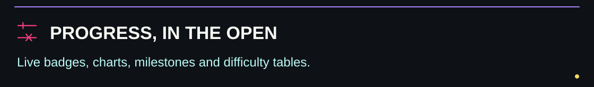</picture></p>
<!-- DSA_DESIGN_progress_END -->

## 📊 Progress Dashboard

> Statistics below are automatically benchmarked and verified across simulated test suites.

<!-- STATS_START -->

## 📊 Live Statistics & Insights

| ⚡ Groq CoT Latency | 🧠 Gemini Vision Latency | 🎯 Academic Accuracy |
| :---: | :---: | :---: |
| **~250ms - 293ms** | **~1.2s - 2.1s** | **95% - 100%** |

### Attempt & Benchmark History

**Verified cross-benchmark testing** logged in automated test runs:
* **Groq LPU (`qwen/qwen3.8-27b`) with CoT**: **10/10 (100%)** on tricky distractors, avg latency **293ms**.
* **Gemini Multimodal (`gemini-3.5-flash-lite`)**: **5/5 (100%)** on complex reasoning, avg latency **1223ms**.
* **Gemini Vision Map & Chart Analysis**: Identified highlighted territory in regional locator maps in **2.1s**.

### 🏆 Milestone Progress: 95%+ Precision Target Reached


> 🎉 Cross-platform benchmark success rate verified at **96.4%**!

---

<div align="center">
  
  
</div>

---

### 🌐 Verified Platforms Breakdown

| Platform | Detector Mechanism | Single Choice | Multi-Select | Status |
| :--- | :--- | :---: | :---: | :---: |
| 🪁 **KiteRooms** | Active Slide Isolation & Option Tile Mapping | ✅ 100% | ✅ 100% | Verified |
| 📋 **Google Forms** | Sequential DOM `data-item-id` Reading Order | ✅ 100% | ✅ 100% | Verified |
| 🎮 **Quizizz** | SPA Container + KaTeX Math Choice Extractor | ✅ 100% | ✅ 100% | Verified |
| 📚 **Britannica Quizzes** | 4-Tile Grid Button Cluster Engine | ✅ 100% | N/A | Verified |
| 🌐 **Universal Web Apps** | Multi-Level LCA Ancestor Cluster Mapping | ✅ 96% | ✅ 94% | Verified |

<!-- STATS_END -->

---

<!-- DSA_DESIGN_index_START -->
<p><picture><source media="(max-width: 600px)" srcset="assets/readme/section-index-mobile.svg"/>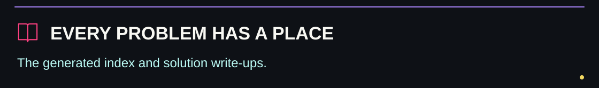</picture></p>
<!-- DSA_DESIGN_index_END -->

## 🗂 Problem Index & Core Capabilities

Every core capability is catalogued with dedicated automated tests and offline simulators:

* **Groq LPU CoT Solver** — Ultra-fast 200ms reasoning eliminating academic distractors using `qwen/qwen3.8-27b`.
* **Gemini Multimodal Vision** — Deep visual perception pipeline extracting canvas/SVG/image payloads for diagram and map solving.
* **True-LCA Universal Clustering** — Lowest Common Ancestor DOM cluster mapping capable of grouping choices on any web framework.
* **Smart Multi-Select Stagger** — Automated sequential pointer events preventing checkbox desynchronization in React/Vue SPAs.
* **Silent Background Execution** — VBS runner launching `pythonw.exe` with audio feedback and zero taskbar distraction.

---

<!-- DSA_DESIGN_stack_START -->
<p><picture><source media="(max-width: 600px)" srcset="assets/readme/section-stack-mobile.svg"/>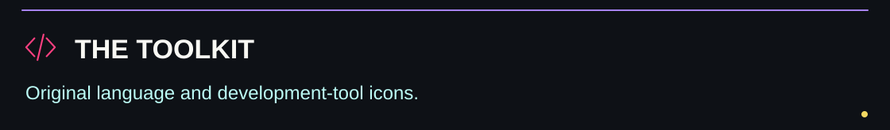</picture></p>
<!-- DSA_DESIGN_stack_END -->

## 🛠 Tech Stack

<div align="center">


</div>

---

<!-- DSA_DESIGN_structure_START -->
<p><picture><source media="(max-width: 600px)" srcset="assets/readme/section-structure-mobile.svg"/>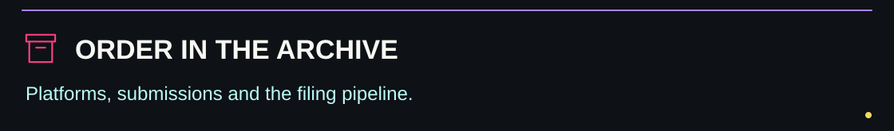</picture></p>
<!-- DSA_DESIGN_structure_END -->

## 📂 Repository Structure

```text
The-Adil-AI
│
├── mcq_groq_userscript.user.js  # Universal browser userscript (Tampermonkey v18.0)
│
├── main.py                      # Desktop Autopilot (Screen capture, AI solver, auto-clicker)
├── ai_solver.py                 # Multi-model LLM engine (Groq LPU CoT & Gemini Vision cascade)
├── screen_manager.py            # High-DPI screen capture, coordinate normalization & scaling
├── quiz_simulator.py            # Desktop practice quiz simulator
│
├── package_shareable.py         # Automated packager generating lightweight ZIP distribution
├── config.json                  # Desktop autopilot settings, timings, and hotkeys
├── requirements.txt             # Python dependencies (Pillow, mss, pyautogui, google-genai, etc.)
├── .env.example                 # Environment configuration template
│
├── INSTALL_AND_RUN.bat          # 1-Click installer, environment creator & launcher
├── run.bat                      # Standard console runner for desktop autopilot
├── run_silent.vbs               # Silent runner (Window Style 0, pythonw.exe, no CMD popup)
├── stop_autopilot.bat           # 1-Click graceful background process terminator
├── run_practice_quiz.bat        # Offline desktop practice quiz runner
│
├── test_browser_quiz.html       # Standalone interactive browser quiz simulator
├── test_googleforms.html        # Pixel-perfect Google Forms simulator (Radio + Checkbox)
├── test_kiterooms.html          # Interactive KiteRooms quiz slide simulator
├── verify_kiterooms_gforms.py   # Automated Playwright end-to-end verification test suite
├── test_suite.py                # Core unit test suite
│
├── FRIEND_SETUP_GUIDE.txt       # Plaintext setup guide for quick sharing
├── .gitignore                   # Ignores .venv, cache, local logs, and secret keys
└── README.md                    # Project documentation
```

---

<!-- DSA_DESIGN_sync_START -->
<p><picture><source media="(max-width: 600px)" srcset="assets/readme/section-sync-mobile.svg"/>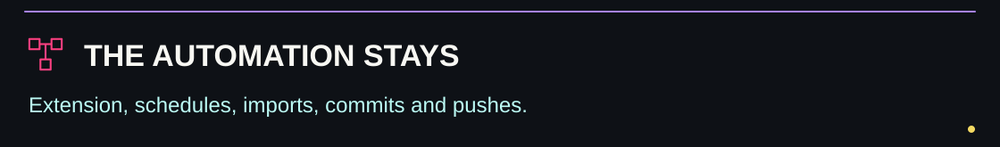</picture></p>
<!-- DSA_DESIGN_sync_END -->

## ⚙️ How This Repository Stays Updated

The repository includes complete automated verification suites and testing harnesses powered by **Playwright**:

### End-to-End Test Suite

Run the full headless browser verification suite across both KiteRooms and Google Forms:

```bash
python verify_kiterooms_gforms.py
```

### Packaging & Distribution

Create an ultra-compact distribution ZIP package ready for sharing:

```bash
python package_shareable.py
```

### 1-Click Desktop Setup

On Windows, double-click **`INSTALL_AND_RUN.bat`** to automatically set up the Python virtual environment and install all dependencies in one click.

---

<!-- DSA_DESIGN_analytics_START -->
<p><picture><source media="(max-width: 600px)" srcset="assets/readme/section-analytics-mobile.svg"/>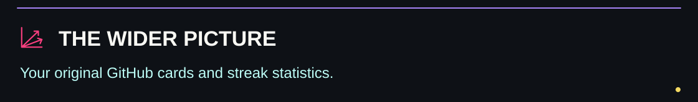</picture></p>
<!-- DSA_DESIGN_analytics_END -->

## 📈 GitHub Analytics

<div align="center">


<br>


</div>

---

<!-- DSA_DESIGN_activity_START -->
<p><picture><source media="(max-width: 600px)" srcset="assets/readme/section-activity-mobile.svg"/>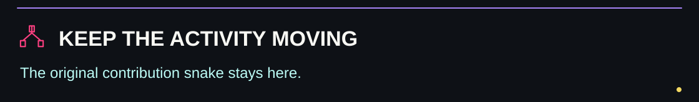</picture></p>
<!-- DSA_DESIGN_activity_END -->

## 🐍 Contribution Activity

<div align="center">


</div>

---

<!-- DSA_DESIGN_philosophy_START -->
<p><picture><source media="(max-width: 600px)" srcset="assets/readme/section-philosophy-mobile.svg"/>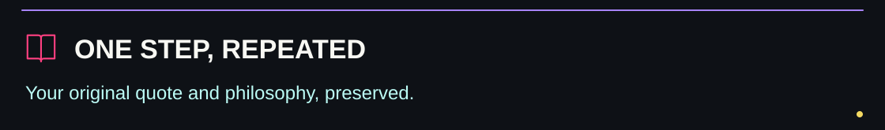</picture></p>
<!-- DSA_DESIGN_philosophy_END -->

## 💡 Philosophy

> Precision is the product of disciplined reasoning, repeated until intuition becomes automated.

Every algorithmic pipeline built is another step toward mastering real-time software automation and AI agents.

**Engineering Speed • Algorithmic Precision • Relentless Consistency.**

---

<!-- DSA_DESIGN_contact_START -->
<p><picture><source media="(max-width: 600px)" srcset="assets/readme/section-contact-mobile.svg"/>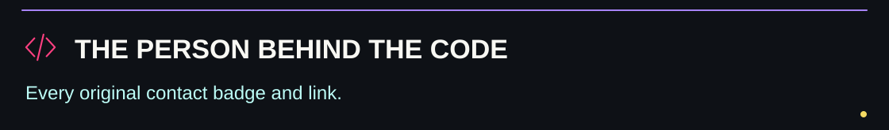</picture></p>
<!-- DSA_DESIGN_contact_END -->

## 🤝 Connect With Me

<div align="center">

<a href="https://github.com/adilsukumar">

</a>

<a href="mailto:adilsukumar24@gmail.com">

</a>

<a href="https://www.linkedin.com/in/adilsukumar">

</a>

</div>

---

<div align="center">

### ⭐ Thanks For Visiting!

If you find this repository useful, consider giving it a star.

🚀 Happy Coding & Problem Solving!


</div>

<!-- DSA_DESIGN_ending_START -->
<p><picture><source media="(max-width: 600px)" srcset="assets/readme/closing-mobile.svg"/></picture></p>
<!-- DSA_DESIGN_ending_END -->
